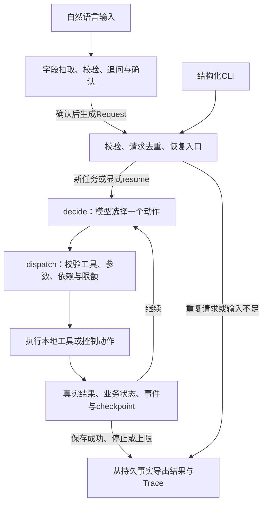

# 方案、动态决策与技术取舍

## 总体执行图

正常路径可以是检索→修订候选→生成脚本→估算→保存。图只提供decide/dispatch循环，不规定模型必须按固定流程完成。模型可以重搜、改档位、复用脚本、重新估算、重试或停止。程序拒绝非法动作，不代替模型选择下一步。

## 技术栈与框架职责

| 组件/版本 | 使用的功能 | 承担的职责 |
|---|---|---|
| Python 3.10.8（实测） | 标准库、类型、CLI、SQLite | 可移植本地应用 |
| LangGraph 1.2.18 | StateGraph、条件路由、运行上限 | 两节点执行循环，避免自建通用调度器 |
| langgraph-checkpoint-sqlite 3.1.2 | SqliteSaver | 任务状态checkpoint与恢复位置 |
| Pydantic 2.12.5 | 严格DTO、字段校验、Schema导出 | 输入、模型脚本和工具参数契约 |
| SQLite（Python内置） | 事务、唯一约束、事件表 | 请求、尝试历史、plan提交事实与防重复 |
| HTTPX 0.28.1 | 同步HTTP、超时、MockTransport | 官方DeepSeek接入及离线协议测试 |
| pytest 9.0.3 / jsonschema 4.26.0 | 测试与公开Schema校验 | 行为、持久状态、CLI及导出验证 |

直接依赖见[pyproject.toml](../pyproject.toml)，完整版本见锁文件。框架的执行图/checkpoint不等同于业务保存成功：事务、估算失效、plan唯一和真实状态由本项目实现。

## 模型与程序的职责

真实模型为官方DeepSeek `deepseek-v4-pro`。planner-v1负责一次决策，通过tools参数发现六项动作；script-v1负责一次无工具脚本生成；intake-v2负责字段Patch抽取。temperature=0、thinking关闭；公开rationale用于解释动作，内部推理不导出。

| 模型选择 | 程序保证 |
|---|---|
| 检索词、素材、创意简述、制作档位 | 素材存在性、来源、参数类型和业务依赖 |
| 观察超限后修改什么、是否再次估算 | 费用、工期、候选/脚本/估算版本一致 |
| 可重试错误后重试或停止 | 重试/动作/模型/候选额度有界，失败历史保留 |
| 满足条件时申请保存 | 当前约束通过且SQLite提交才completed |

`generate_script`内部调用一次真实生成模型，不是第二个自主Agent。该请求同样计入32次业务模型上限。HTTP适配器不隐藏自动重试；错误交回外层模型决策。自然语言抽取用量单列，每个草稿最多8次，不混入业务额度。

## 工具与模块

| 动作 | 返回与约束 |
|---|---|
| search_materials | 合成资料检索，返回事实/版本/费用，并累积已见素材 |
| revise_plan | 基于已见素材创建候选；重复内容不增版，修改使旧估算失效 |
| generate_script | 生成并校验当前候选脚本；同输入指纹可复用已有脚本 |
| estimate_cost | 分项报价、工期、可行性、缺口及同素材另一档位报价 |
| save_plan | 检查最新依赖与当前时间，在事务中保存唯一plan与成功事实 |
| stop_task | 记录明确未完成原因；停止动作成功不代表任务完成 |

六项动作使用显式白名单和Pydantic Schema，不提供任意代码、文件或网络工具。详细字段见[下文参数与错误语义](#工具参数与错误语义)及[机器可读Schema](../contracts/tools.json)。

| 代码模块 | 主要职责 |
|---|---|
| cli.py / scripts/interactive_planner.py / intake.py | 结构化CLI、自然需求草稿和确认 |
| service.py / graph.py / agent.py | 去重/续跑、执行图、模型上下文与动作分派 |
| model.py / deepseek.py / prompts.py | 可替换模型边界、HTTP适配和版本化提示 |
| domain.py / catalog.py / tools.py | 领域约束、合成资料、确定性报价及工具行为 |
| storage.py / reporting.py | SQLite事实、事务、结果与Trace导出 |

ModelClient与Clock隔离非确定性，其余以普通函数和小型Repository实现。开发用AI、技能文档和HANDOFF均不进入应用运行链路。

## 工具参数与错误语义

模型每轮只能选择一个白名单动作，携带真实tool_call_id与原始JSON arguments；rationale是可公开的简要理由，不参与业务缓存指纹。所有动作先做严格参数/依赖校验，再记录结果。完整字段/范围见[工具Schema](../contracts/tools.json)与[共用结果Schema](../contracts/common.schema.json)。

| 动作 | 模型可提供的业务参数（另有rationale） | 核心前置、返回和错误 |
|---|---|---|
| search_materials | query（1—200）、top_k（严格整数1—5） | 返回query/catalog_hash/materials；空数组仍成功；CATALOG_UNAVAILABLE可重试 |
| revise_plan | 已见material_id、creative_brief（1—500）、production_mode（basic/premium） | 返回revision、candidate_hash、script_input_hash及失效项；未见素材拒绝，不能修改用户输入 |
| generate_script | 当前plan_revision | 从可信候选读取素材/brief；返回title/hook/body/cta/source_ids与程序生成ID；旧版本/缺候选拒绝，非法JSON/来源/禁用表述为SCRIPT_INVALID |
| estimate_cost | 当前plan_revision | 必须已有匹配脚本；返回四分项、合计/预计结束、可行性、缺口及另一档位报价；旧版本/无脚本拒绝 |
| save_plan | 当前plan_revision、最新estimate_id | 保存前重验时间/依赖，返回plan_id、content_hash和saved_plan；旧估算/不可行拒绝，事务失败为SAVE_FAILED |
| stop_task | reason（no_material/constraints_unsatisfied/tool_failure）、message（1—500） | 必须有空检索/不可行报价/未解决失败的相应证据；无依据为STOP_REASON_UNSUPPORTED；返回incomplete、缺口与保留产物 |

ToolResult统一含tool_call_id、tool、ok、reused、data、error。成功有data、error=null；失败相反。retryable只表示同参数可再尝试，是否重试仍由模型选择。估算顺利算出超限是ok=true/feasible=false，不是工具失败；空检索也不能被写成宕机。单次结果的真假不等于任务是否completed。

检索对query做NFC/lower/trim，按别名长词优先替换，再按不同tag命中数降序、material_id升序排序；不使用embedding/BM25。成功检索累加seen集合。脚本标题/开头/正文/CTA长度上限为100/200/2000/200，source_ids恰含当前一个素材；生成失败不缓存成功产物。

估算另一档位仅针对同素材、同brief和草稿，不宣称遍历全库。预算缺口=max(total-budget,0)，期限缺口=max(ceil((finish-deadline)/60秒),0)，含秒/微秒边界。每次估算重新取时，同次当前/替代报价共用时刻；estimate_id由真实工具调用ID派生，避免同秒碰撞。

保存不接收模型给的价格、脚本正文、request_id或目标路径。约束拒绝包含当前缺口；无提交时不能返回已保存。相同内容重放复用原plan，不同内容报SAVE_CONFLICT。程序先查到提交事实，再导出Markdown；EXPORT_FAILED不抹去已保存状态。

## 一次真实重规划

[E04实际证据](../examples/live/core20/20261031T110356Z-93ca1d21/E04/observations.json)中，初始premium报价12、预算10、缺口2，工具同时返回basic8可行。模型观察后选择revise_plan改basic。候选升到revision2，latest_estimate清空，旧报价留在历史；脚本因输入未变而保留。模型再调用estimate_cost得到8，再用新estimate_id保存。

程序没有`if over_budget: production_mode = basic`。预算计算正确和模型根据反馈调整，是两项分别验证的要求。6例给定初始方案有fixture_setup标记，不冒充模型从空输入自主产生premium。

## 任务记忆、上下文与恢复

持久记忆包括已见素材、候选历史、脚本产物、估算历史、最近观察、未解决失败、合法消息和尝试事件。checkpoint负责恢复执行位置，SQLite业务表负责实际保存事实；不同职责在结果中交叉核对。

模型每轮收到不可变需求/报价、工具Schema、当前候选、有效脚本摘要、当前与历史报价、最近观察、未解决失败和剩余额度。最近完整消息组最多12000个JSON字符，旧组由实际结果生成动作/ok/error_code摘要；完整历史仍持久化。整体上下文最多65536 UTF-8字节，必要事实超限明确停止，不丢预算/期限。没有额外摘要模型或跨任务长期记忆。

同ID同输入run只读，变更输入拒绝；resume才续跑，限额累计。已持久化且仍有效的脚本/工具结果复用；变更素材/创意会使脚本失效，仅变更档位可保留脚本但必须重估。已提交plan优先于checkpoint报告完成。外部请求结果若未落盘则仍未知，恢复可能再次调用，不承诺exactly-once。详见[下文状态存储与事务](#状态存储与事务)。

## 状态存储与事务

| 权威事实 | 存放/约束 |
|---|---|
| 已确认用户要求 | requests：request_id主键、不可变input_json/input_hash、backend/model/manifest |
| 候选、有效产物、合法消息和恢复位置 | LangGraph checkpoint；JSON兼容TypedDict，不存客户端/连接 |
| 真实尝试与累计计数 | events：event_id有序，UNIQUE(request_id,operation_id,phase)；先提交started再调用外部能力 |
| 保存是否成功 | plans：request_id UNIQUE、plan_id、content_hash、payload_json；提交事实优先于checkpoint |
| 面向评审的文件 | JSON/Markdown/JSONL均是导出，可重建；不能反过来制造业务成功 |

状态路径为输入不足→needs_input（不注册业务任务）；合法新请求→running；仅plan提交后→completed；停止/错误/上限→incomplete；仅显式合法resume才重新running。attempt分别保留started/succeeded/failed/rejected；只有started而无结果的中断标interrupted/未知，不推定成功。

业务表与SqliteSaver共用runtime.db的不同连接，不能假设checkpoint和业务保存是跨连接原子事务。应用开启foreign_keys、WAL、busy_timeout=5000ms和schema_version=1校验，不做通用数据库迁移。保存plan、成功事件和可信状态补丁在同一事务；失败全部回滚，之后才更新内存。提交后checkpoint未落盘时，下一入口查plans恢复完成，不再次生成/保存。

AgentState保留request/manifest、status/reason/message、decision_seq、consecutive_protocol_errors、pending_call、planner_messages、seen_material_ids、candidate_history/current_revision、script_artifacts、estimate_history/current_estimate_id、tool_results/last_observation、saved_plan_id及未解决失败。累计调用数从events派生，不能由模型写入或在续跑时重置。已验证补丁按operation/产物/revision幂等合并，避免重放重复追加。

planner的operation形如decide:序号，工具为tool:原调用ID，内部脚本模型请求关联该工具的:script。恢复按operation和kind共同核对持久结束事件；已存响应/产物复用，未知结果标interrupted并用recovery后缀记录新尝试。合法tool_call_id即使包含:script等字符也不能与不同kind事件混用。

## 指纹、失效与续跑准入

指纹采用UTF-8 canonical JSON（排序键、无多余空白）和SHA-256；文本NFC/trim，时间归一UTC。input_hash不含request_id；candidate_hash含输入指纹、素材内容、brief、档位和报价内容哈希；script_input_hash含主题/受众/平台、素材内容、brief、脚本提示版本、模型和thinking，不含制作档位/预算/期限。rationale、调用ID和时刻不进入内容指纹。

| 变更/入口 | 保留与失效规则 |
|---|---|
| 仅换制作档位 | 保留匹配脚本、废弃当前估算，重新计算后才可保存 |
| 换素材/brief | 旧产物留历史，但当前脚本/估算失效；同候选重复不增revision |
| 改预算/期限/主题 | 原Request不可改，创建新ID；同ID不同输入REQUEST_CONFLICT |
| 同ID同输入run/show | 只读已有事实，截止时间后来已过也不能把历史成功改失败 |
| completed resume | 原plan直接返回，零新调用，不要求当前密钥/资料 |
| 未完成resume | 检查checkpoint、manifest、可恢复原因和剩余额度，保留原期限与累计历史 |

manifest记录三份资料内容哈希、planner/script提示版本、model_id、thinking和契约版本；版本名相同而内容变化仍识别。旧任务续跑配置变化为MANIFEST_MISMATCH，缺checkpoint为CHECKPOINT_NOT_FOUND，不可恢复停止为RESUME_NOT_ALLOWED。拒绝不修改原任务；历史show不受当前资料变化影响。

可恢复原因包括MODEL_UNAVAILABLE、仍适用的可重试工具失败及未完成的框架节点。无素材、约束停止、非法脚本、认证/协议/额度上限等不自动恢复；输入变化新建任务。框架有pending next/tasks时invoke(None)，正常可恢复结束则保留状态后从decide继续。外部模型已返回但响应未持久时结果未知，可能再次产生费用，不承诺API exactly-once。

## 限额与协议处理

| 限制 | 行为 |
|---|---|
| 业务模型请求32次 | planner和script及失败尝试均计入；达到上限明确未完成 |
| 工具/控制动作24次 | 成功/失败/复用均计动作；不把缓存命中当新HTTP |
| 候选4版 | 含初始方案，不创建第5版 |
| 同参数可重试失败2次 | 初次+一次重试，第三次拒绝；模型可改有意义参数或停止 |
| 连续协议错误2次 | 合法动作清计数；第二次连续错误停止 |
| 图recursion_limit=80 | 框架循环上限兜底，映射GRAPH_LIMIT_REACHED |

重试键按动作有效输入生成，排除rationale、tool_call_id与当前时间；改变无关措辞或estimate_id不能绕过保存重试限额。多调用响应整组拒绝，不只执行第一个；能配对则逐原ID反馈错误，不能合法回传时停止。普通文本不能代替save/stop，返回MODEL_STOPPED并保留草稿。

## 设计取舍

选择轻量LangGraph循环，是因为题目只需要一个有界、可续跑的决策主体。调研并讨论DeepAgents后保留当前路线，避免引入文件工具、子Agent和长期记忆等当前业务不需要的能力。SQLite便于本地事务/幂等验证，但不支持同一任务多进程并发。

合成资料以包内数据安装，检索使用稳定别名与标签匹配，不引入向量库。费用和时间精确计算，语言模型不承担算账。脚本检查保证结构、来源及已知禁止表述，不能证明所有语言命题。

自然入口将字段理解与业务执行分开：原文依据→Patch→程序规范化→用户确认→Request。现阶段回复为固定模板，尚不具备结合运行任务自由聊天和自然语言修改路由；这是产品体验后续项，不改变已验证的预算/失败/状态闭环。

## 框架调研与路线选择

项目调研时比较了原生Python循环、LangGraph、PydanticAI、AgentScope和Google ADK。原生循环容易实现最小闭环，但续跑/执行位置要自行维护；PydanticAI的类型/测试能力合适，当时所查主分支与本机Python版本还需额外兼容选择；AgentScope/ADK具备可用工具/工作流能力，当前单任务没有需要其更广运行能力的业务。最终选LangGraph薄图与SQLite，将执行位置交给框架，将预算/依赖/事务留在领域代码。没有进行框架性能基准，不能把取舍写成普遍性能优劣。

调研/后续讨论后不接DeepAgents、LangSmith账户、远端checkpoint、ORM、队列或向量库。公开依赖锁与包内资料支持普通Python环境；框架名称不作为效果依据。HTTP只用HTTPX直接适配实际协议，避免再维护完整模型SDK封装。

## HTTP与需求入口接入

官方POST /chat/completions，非流式，planner max_tokens=2048、script=1536、intake=1024。planner发六工具Schema和实际配对消息，tool_choice=auto；script/intake不发工具，使用json_object输出，再本地校验。不发送未采用的parallel_tool_calls或Beta strict；HTTP不自动重试、不跟随重定向。

分项超时connect=5/read=45/write=10/pool=5秒，不等于严格总时长SLA。401/403→AUTH_ERROR；其他4xx/重定向→MODEL_CONFIG_ERROR；429/5xx/连接/超时→可恢复MODEL_UNAVAILABLE；非法封装/截断→MODEL_PROTOCOL_ERROR。脚本普通瞬时失败映射SCRIPT_MODEL_UNAVAILABLE；认证/配置/协议失败保留代码并停止，不额外请求planner解释同一错误。真实usage按安全返回记录，任何尝试未知则总token保守为null；美元账单未知保持null。

IntakePatch只允许topic/budget_units/deadline_at及本轮原文依据；遗漏键保留旧值，显式清除须有依据。预算/时间value必须逐字复制source，由程序解析、验证和合并，模型不能自行算绝对日期或放宽预算。每次修改增版本，使旧确认失效；只在确认后接run_task。草稿只在内存，安全intake.jsonl记录字段变更/锚点/版本/确认关联与用量，不记录完整自由对话或原provider错误body。

结构化CLI读环境凭证；交互/评测按明确授权可从隐藏提示直接注入内存，不写env文件或argv。客户端由创建者负责关闭。重复run/show/completed resume先查持久事实，不为历史查询要求模型密钥。模型响应中的推理/认证信息不落日志，安全Trace保留动作和必要观察。

## 真实模式与离线模式

真实模式使用DeepSeek planner和脚本生成，检索/估算/保存是实际本地工具，资料合成。离线模式仅替换模型/Clock，使用相同业务实现、真实临时SQLite与checkpoint。Fake动作显式声明，结果标记mock；离线测试不证明模型智能。

故障在外部模型边界或实际SQLite事务注入，返回真实失败观察；模型不接触评测预期。模型效果、程序约束及内容质量分别报告，见[评估](03-evaluation.md)。

## 调研来源

以下为项目调研时使用的公开官方资料，说明采用的能力；不将文档阅读替代真实运行或宣称已重新做版本性能比较。

- [LangGraph overview](https://docs.langchain.com/oss/python/langgraph/overview)：确定性与模型步骤组合，不强制使用 LangChain。
- [LangGraph quickstart](https://docs.langchain.com/oss/python/langgraph/quickstart)：模型节点、工具节点与回环。
- [LangGraph persistence](https://docs.langchain.com/oss/python/langgraph/persistence)：checkpointer 的线程执行状态与 store 的区别。
- [LangGraph Graph API](https://docs.langchain.com/oss/python/langgraph/use-graph-api)：recursion limit。
- [LangGraph 包版本](https://pypi.org/project/langgraph/1.2.18/)；[SQLite checkpointer 版本](https://pypi.org/project/langgraph-checkpoint-sqlite/3.1.2/)。
- [PydanticAI testing](https://pydantic.dev/docs/ai/guides/testing/)：TestModel/FunctionModel 与模型评估边界。
- [PydanticAI Agent](https://pydantic.dev/docs/ai/core-concepts/agent/)：UsageLimits；[项目 Python 版本要求](https://github.com/pydantic/pydantic-ai/blob/main/pyproject.toml)。
- [AgentScope ReActAgent](https://doc.agentscope.io/tutorial/task_agent.html)。
- [Google ADK 工作流](https://adk.dev/agents/workflow-agents/)。
- [DeepSeek 模型与能力](https://api-docs.deepseek.com/quick_start/pricing/)：模型 ID、协议与功能；本项目不固定其可能变化的真实价格。
- [DeepSeek Chat Completions](https://api-docs.deepseek.com/api/create-chat-completion/)：消息、函数调用和参数校验要求。
- [DeepSeek Tool Calls](https://api-docs.deepseek.com/guides/tool_calls/)：调用回传与 Beta strict 模式。
- [DeepSeek JSON output](https://api-docs.deepseek.com/guides/json_mode/)：JSON 输出配置与本地校验需求。
- [Pydantic models](https://pydantic.dev/docs/validation/latest/concepts/models/)；[pytest monkeypatch](https://docs.pytest.org/en/stable/how-to/monkeypatch.html)。
- [Python sqlite3](https://docs.python.org/3.10/library/sqlite3.html)；[HTTPX timeouts](https://www.python-httpx.org/advanced/timeouts/)。
