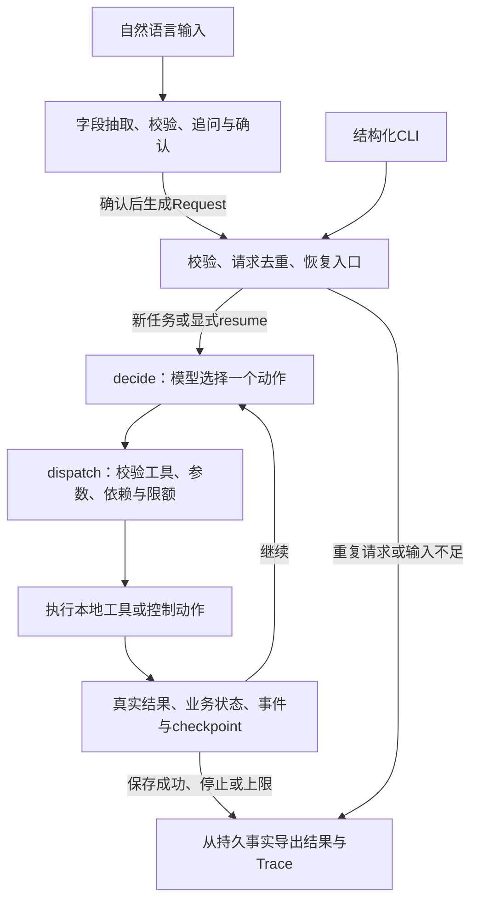

# 方案、动态决策与技术取舍

## 总体执行图

正常路径可以是检索→修订候选→生成脚本→估算→保存。图只提供decide/dispatch循环，不规定模型必须按固定流程完成。模型可以重搜、改档位、复用脚本、重新估算、重试或停止。程序拒绝非法动作，不代替模型选择下一步。

## 技术栈与框架职责

| 组件/版本 | 使用的功能 | 承担的职责 |
|---|---|---|
| Python 3.10.8（实测） | 标准库、类型、CLI、SQLite | 可移植本地应用 |
| LangGraph 1.2.18 | StateGraph、条件路由、运行上限 | 两节点执行循环，避免自建通用调度器 |
| langgraph-checkpoint-sqlite 3.1.2 | SqliteSaver | 任务状态checkpoint与恢复位置 |
| Pydantic 2.12.5 | 严格DTO、字段校验、Schema导出 | 输入、模型脚本和工具参数契约 |
| SQLite（Python内置） | 事务、唯一约束、事件表 | 请求、尝试历史、plan提交事实与防重复 |
| HTTPX 0.28.1 | 同步HTTP、超时、MockTransport | 官方DeepSeek接入及离线协议测试 |
| pytest 9.0.3 / jsonschema 4.26.0 | 测试与公开Schema校验 | 行为、持久状态、CLI及导出验证 |

直接依赖见[pyproject.toml](../pyproject.toml)，完整版本见锁文件。框架的执行图/checkpoint不等同于业务保存成功：事务、估算失效、plan唯一和真实状态由本项目实现。

## 模型与程序的职责

真实模型为官方DeepSeek `deepseek-v4-pro`。planner-v1负责一次决策，通过tools参数发现六项动作；script-v1负责一次无工具脚本生成；intake-v2负责字段Patch抽取。temperature=0、thinking关闭；公开rationale用于解释动作，内部推理不导出。

| 模型选择 | 程序保证 |
|---|---|
| 检索词、素材、创意简述、制作档位 | 素材存在性、来源、参数类型和业务依赖 |
| 观察超限后修改什么、是否再次估算 | 费用、工期、候选/脚本/估算版本一致 |
| 可重试错误后重试或停止 | 重试/动作/模型/候选额度有界，失败历史保留 |
| 满足条件时申请保存 | 当前约束通过且SQLite提交才completed |

`generate_script`内部调用一次真实生成模型，不是第二个自主Agent。该请求同样计入32次业务模型上限。HTTP适配器不隐藏自动重试；错误交回外层模型决策。自然语言抽取用量单列，每个草稿最多8次，不混入业务额度。

## 工具与模块

| 动作 | 返回与约束 |
|---|---|
| search_materials | 合成资料检索，返回事实/版本/费用，并累积已见素材 |
| revise_plan | 基于已见素材创建候选；重复内容不增版，修改使旧估算失效 |
| generate_script | 生成并校验当前候选脚本；同输入指纹可复用已有脚本 |
| estimate_cost | 分项报价、工期、可行性、缺口及同素材另一档位报价 |
| save_plan | 检查最新依赖与当前时间，在事务中保存唯一plan与成功事实 |
| stop_task | 记录明确未完成原因；停止动作成功不代表任务完成 |

六项动作使用显式白名单和Pydantic Schema，不提供任意代码、文件或网络工具。详细字段见[工具契约](06-contracts.md)及[机器可读Schema](../contracts/tools.json)。

| 代码模块 | 主要职责 |
|---|---|
| cli.py / scripts/interactive_planner.py / intake.py | 结构化CLI、自然需求草稿和确认 |
| service.py / graph.py / agent.py | 去重/续跑、执行图、模型上下文与动作分派 |
| model.py / deepseek.py / prompts.py | 可替换模型边界、HTTP适配和版本化提示 |
| domain.py / catalog.py / tools.py | 领域约束、合成资料、确定性报价及工具行为 |
| storage.py / reporting.py | SQLite事实、事务、结果与Trace导出 |

ModelClient与Clock隔离非确定性，其余以普通函数和小型Repository实现。开发用AI、技能文档和HANDOFF均不进入应用运行链路。

## 一次真实重规划

[E04实际证据](../examples/live/core20/20261031T110356Z-93ca1d21/E04/observations.json)中，初始premium报价12、预算10、缺口2，工具同时返回basic8可行。模型观察后选择revise_plan改basic。候选升到revision2，latest_estimate清空，旧报价留在历史；脚本因输入未变而保留。模型再调用estimate_cost得到8，再用新estimate_id保存。

程序没有`if over_budget: production_mode = basic`。预算计算正确和模型根据反馈调整，是两项分别验证的要求。6例给定初始方案有fixture_setup标记，不冒充模型从空输入自主产生premium。

## 任务记忆、上下文与恢复

持久记忆包括已见素材、候选历史、脚本产物、估算历史、最近观察、未解决失败、合法消息和尝试事件。checkpoint负责恢复执行位置，SQLite业务表负责实际保存事实；不同职责在结果中交叉核对。

模型每轮收到不可变需求/报价、工具Schema、当前候选、有效脚本摘要、当前与历史报价、最近观察、未解决失败和剩余额度。最近完整消息组最多12000个JSON字符，旧组由实际结果生成动作/ok/error_code摘要；完整历史仍持久化。整体上下文最多65536 UTF-8字节，必要事实超限明确停止，不丢预算/期限。没有额外摘要模型或跨任务长期记忆。

同ID同输入run只读，变更输入拒绝；resume才续跑，限额累计。已持久化且仍有效的脚本/工具结果复用；变更素材/创意会使脚本失效，仅变更档位可保留脚本但必须重估。已提交plan优先于checkpoint报告完成。外部请求结果若未落盘则仍未知，恢复可能再次调用，不承诺exactly-once。详见[状态与存储](07-state-and-storage.md)。

## 设计取舍

选择轻量LangGraph循环，是因为题目只需要一个有界、可续跑的决策主体。调研并讨论DeepAgents后保留当前路线，避免引入文件工具、子Agent和长期记忆等当前业务不需要的能力。SQLite便于本地事务/幂等验证，但不支持同一任务多进程并发。

合成资料以包内数据安装，检索使用稳定别名与标签匹配，不引入向量库。费用和时间精确计算，语言模型不承担算账。脚本检查保证结构、来源及已知禁止表述，不能证明所有语言命题。

自然入口将字段理解与业务执行分开：原文依据→Patch→程序规范化→用户确认→Request。现阶段回复为固定模板，尚不具备结合运行任务自由聊天和自然语言修改路由；这是产品体验后续项，不改变已验证的预算/失败/状态闭环。

## 真实模式与离线模式

真实模式使用DeepSeek planner和脚本生成，检索/估算/保存是实际本地工具，资料合成。离线模式仅替换模型/Clock，使用相同业务实现、真实临时SQLite与checkpoint。Fake动作显式声明，结果标记mock；离线测试不证明模型智能。

故障在外部模型边界或实际SQLite事务注入，返回真实失败观察；模型不接触评测预期。模型效果、程序约束及内容质量分别报告，见[评估](03-evaluation.md)。
