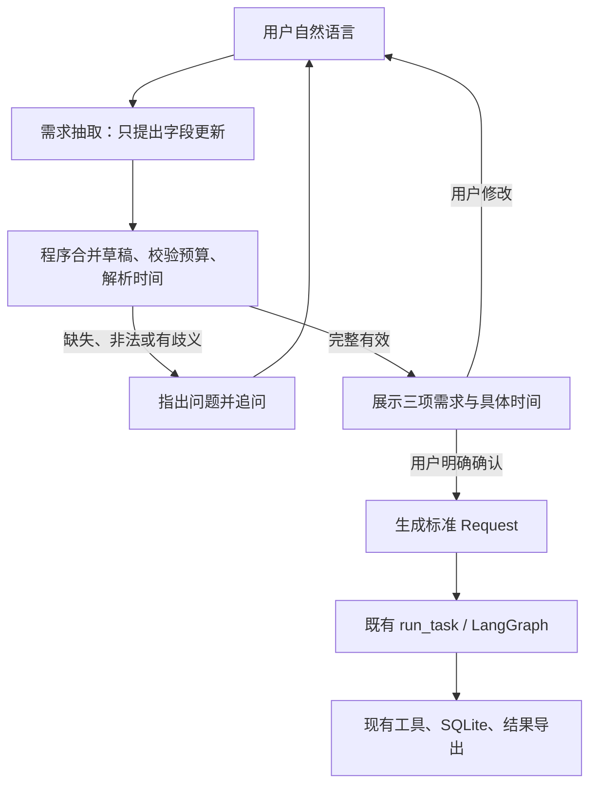

# 自然语言需求入口开发方案

2026-10-31。状态：**N1/N2/N3开发、自验与评测已完成，用户验收pending**。用户明确连续授权N1/N2/N3开发与评测，覆盖中间等待，但不代填用户验收。实际证据见[N1](stages/N1.md)、[N2](stages/N2.md)、[N3](stages/N3.md)，下方是需求与验收预期。S8未开始，保留旧JSON终端及已有任务。

## 目标与交互

用户描述需求，系统收集主题、模拟预算和明确截止时间，展示整理结果，经用户确认后提交现有规划Agent。request_id由程序生成，作为查询、幂等和续跑编号，不要求运营人员手工编写。

示例（假定当前北京时间为2026-10-31）：

```text
用户：帮我做影芽剪辑字幕功能的推广方案。
系统：还需要预算和最晚完成时间。预算是多少个模拟单位？最晚什么时候完成？
用户：预算10个单位，明天下午6点前。
系统：主题：影芽剪辑字幕功能推广
      预算上限：10个模拟单位
      最晚完成：2026-11-01 18:00，北京时间 UTC+08:00
      输入“确认”开始，或继续描述需要修改的内容；“取消”放弃草稿。
用户：预算改成8，时间不变。
系统：展示更新后的三项信息，重新等待确认。
用户：确认
系统：生成任务编号，进入实际检索、候选、脚本、估算、修订/停止、保存链路。
```

首版继续使用当前终端。确认前的需求理解可能调用DeepSeek并产生token用量；确认只控制业务Agent和业务工具的启动，不承诺确认前零API费用。输入“确认”“取消”等明确控制指令由程序处理，不为这些指令额外调用模型。

## 总体结构与责任



- **需求理解模型**：使用现有官方DeepSeek HTTP客户端，一次结构化JSON抽取；识别本轮明确提供/修改的字段及其原文依据。它不调用业务工具、不决定费用或完成状态，不作为第二个自主Agent。
- **程序会话层**：合并字段、处理缺失/冲突/清除、规范化时间、决定追问、展示确认摘要、控制提交和幂等。模型返回严格Pydantic校验后才生效，非法输出保留原草稿并给可操作提示。
- **现有业务Agent**：只接收已确认的现行Request，继续负责选择动作并根据工具反馈重规划。费用、工期、保存校验、步骤状态、失败续跑沿用当前实现。

采用同一真实模型的独立`intake-v2`提示（N3从v1升级，保留失败）及专用抽取方法，保持planner/script职责清楚；复用HTTPX、Pydantic、Clock及现有安全错误处理，无新增SDK/日期库。业务HTTP参数仍按当前模型约定，抽取请求不带业务工具。

## 数据、状态与关键规则

**数据边界。** 现行Request保持四字段。新增内部IntakeDraft与严格IntakePatch；Patch只允许主题、预算、截止时间更新，附当前用户语句中的依据片段。遗漏键表示保持旧值；显式清除必须有用户本轮依据。topic按现行NFC/trim/长度规则验证；预算沿用正整数及上限，禁止四舍五入或隐式货币换算。原文引用可核对更新来源，用户确认负责最终核对整理后的含义，不把模型置信度作为事实证明。

**会话状态。** 草稿收集 → 待确认 → 执行中 → 已提交/结果可查；取消清空当前未提交草稿。每次字段修改增加草稿版本并使旧确认失效；完整有效才显示待确认。确认时重新检查deadline仍未来、请求类型仍合法，再为该版本分配稳定request_id并且仅提交一次。连续“确认”读取已有任务；用户改变已提交需求则新建请求，遵守原输入不可变规则。

**多轮保留。** “预算改成8，其他不变”只更新预算，主题和截止时间保留。“预算还没定”清除预算并追问。草稿首版仅保存在当前进程内存，重启会丢失未提交对话；确认后的业务任务仍按现有SQLite持久化/续跑。此限制应在启动说明中明确。

**时间解释。** 固定展示时区为北京时间UTC+08:00，内部UTC，继续使用可注入Clock。每个截止时间表达保存收到该表达的基准时刻；修改预算、展示摘要或次日确认均不重新滚动“明天”。更新截止时间时才建立新锚点。模型提取用户的时间原文，程序按限定规则规范化，而不是直接相信模型自行算出的绝对日期。

首版支持：带偏移ISO时间、明确年月日和时刻、今天/明天/后天加明确时刻（包括“明天下午六点”等常见表达）。“明天”“周五”“月底”“尽快”“下班前”等缺日期或时刻、无明确语义约定的表达先追问；过期、非法日期、无效时间拒绝；显示具体年月日、时分和时区供确认。具体解析语法与正反例在N1先写入契约，不为未支持的表达猜默认时间。

**预算解释。** 界面明确使用模拟单位。“预算10”在该业务上下文显示为10个模拟单位待确认；“10元/美元”、小数、范围或“差不多”等不能被静默换算、取整或选择上限，要指出不支持/请明确整数硬上限。

**错误、调用和可观察性。** 每个普通输入轮最多一次抽取请求，无后台自动重试；建议首版每草稿最多8次抽取、单条最多2000字符，达到上限保留草稿并明确提示。取消、确认和既有show/resume/exit走程序控制。认证/协议/网络故障保留草稿，不创建业务请求或误报执行成功。需求理解调用次数和实际token单独展示，与业务32次模型/24次动作额度分开统计；未知用量为null。补充安全的草稿版本、字段变更、时间锚点、确认/提交关联和用量事件，不额外持久化完整自由对话、认证信息、provider错误body或内部推理。

## 模块调整建议

| 位置 | 计划调整 | 验证入口 |
|---|---|---|
| 新增intake.py | DTO、草稿/确认状态、字段合并、限定时间解析、明确追问与提交结果 | 注入抽取替身与Clock，直接验证会话可观察结果 |
| deepseek.py / prompts.py | 新增专用抽取方法与当前intake-v2提示；复用既有客户端和错误映射 | HTTPX MockTransport验证实际请求/安全响应/usage |
| scripts/interactive_planner.py | 默认自然语言模式，接入追问/确认；提供显式JSON兼容模式；父/子启动传递输入模式 | stdin/stdout及CLI子进程验证；Windows启动复核 |
| service.py及当前工具/图 | 通过既有run_task/export/show/resume衔接 | 真实临时SQLite，确认前后执行与行数断言 |
| docs/contracts/tests | 在实现阶段更新权威规格、增加验收和报告 | 规格对照、聚焦测试与必要回归 |

入口默认模式切换在N2集成时完成；现有`python -m content_planner run --input ...`与结构化输入保留。自然语言模式中不会因误贴JSON而绕过确认，JSON兼容模式需显式选择。当前已启动的旧JSON进程在规划期间保持原状；升级后在无任务执行时显式重启并重新安全注入密钥，不尝试读取旧进程内的凭据。

## 分阶段开发与停止点

| 阶段 | 实施范围 | 完成标准与交付 |
|---|---|---|
| N1：契约与会话核心 | 先更新需求/输入/状态/验收规格，冻结首版时间语法；用抽取替身实现草稿、合并、校验、追问、确认与稳定请求ID | 逐行为TDD；缺信息/未确认/取消均零业务调用及零业务数据库新行；修改后再确认；固定Clock边界通过；提交报告及HANDOFF后等待验收 |
| N2：真实适配与终端集成 | 接入DeepSeek专用JSON抽取；终端自然语言输入、摘要确认、JSON兼容、用量/安全事件及实际run_task | 协议离线测试、真实SQLite的多轮到保存、重复确认不重复调用、错误保留草稿、旧JSON及Windows启动回归；双轴审查修复后交付等待验收 |
| N3：真实端到端效果评测与使用交付 | 在已验证入口上实际输入自然语言，保存输入整理证据、确认后的Request、业务输出/Trace/数据库核查及报告 | 从终端启动至结果的真实案例；分别报告提取、对话、业务、内容事实性、调用/时间指标，保留所有失败；更新启动说明/HANDOFF，停止扩展 |

原规划回合只交付方案；随后用户明确授权连续完成N1/N2/N3。本轮按阶段依次实施、自验、审查和更新交接，不在中间等待再次授权，不把连续开发视为用户已验收或S8授权。实现阶段使用项目规定的karpathy-guidelines、tdd、接口设计与双轴code-review。

## 必须验证的案例与指标（验收预期，实际结果见阶段报告）

| Case | 场景 | 独立判定 |
|---|---|---|
| N-A01 | 一句话给齐三项 | topic/预算精确匹配；时间与独立固定算例匹配；确认前无业务调用，确认后保存 |
| N-A02 | 只说主题，再补预算，再补时间 | 只追问未明确项；字段按轮保留，不能编造默认预算/期限 |
| N-A03 | 待确认时改预算或时间 | 更新指定字段，其他不变，重新展示确认；旧确认无效 |
| N-A04 | 明天下午六点、跨日后补预算 | 首次时间锚点稳定；预算修改不使日期滚动；确认时复核过期 |
| N-A05 | 尽快/只有明天/非法日期/金额单位或小数 | 要求明确或拒绝，不静默修正，不创建业务任务 |
| N-A06 | 取消、重复确认、已提交后新需求 | 取消零业务执行；重复只读；新输入新ID，无重复plan |
| N-A07 | 抽取JSON非法、额外字段、注入指令、401/超时 | 严格拒绝/安全报错，保留草稿；不放宽硬约束或越过确认 |
| N-A08 | 确认后业务生成失败与显式resume | 原失败、成功素材和既有额度保留；输入整理故障与业务失败分开 |
| N-A09 | 预算5确认执行、缺可行方案 | 返回已评估成本/缺口及incomplete，plan0行 |
| N-A10 | JSON兼容入口与Windows新窗口 | 原模式行为可复现；模式传递正确；启动零HTTP；用户输入前不执行 |

N3首批真实样本拟为：完整一句话、分轮补充/修改、模糊时间澄清后预算不足，各1次；包含真实终端的确认前零业务操作及确认后实际执行证据。无需模型的取消/重复确认/启动等性质主要用离线断言，避免为确定性事实增加付费样本。真实运行需当时授权和可用密钥，不为制定计划而调用。

报告分别给出字段提取逐项正确/错误、追问必要性与轮数、确认/幂等检查、业务目标结果、内容事实性及用量/时间。样本少仅报告次数，不宣称泛化成功率。自然语言理解用例不能替代已建立的L04给定12→8重规划检查；原脚本事实性缺口仍单列，新增入口不代表该缺口自动解决。

## 原规划回合记录

已阅读HANDOFF、S7手工入口报告、现有模型/Request/提示/交互代码及阶段规则，核对main/6885d85与所有既有未提交改动。当前JSON业务进程PID32492仍存在，状态文件记录ready及上次记录的HTTP0；该文件不是实时用量监控。本回合仅修改规划与交接文档，无代码改动、新测试、环境安装、进程重启或真实API调用；所有新增用例状态为NOT_RUN。
