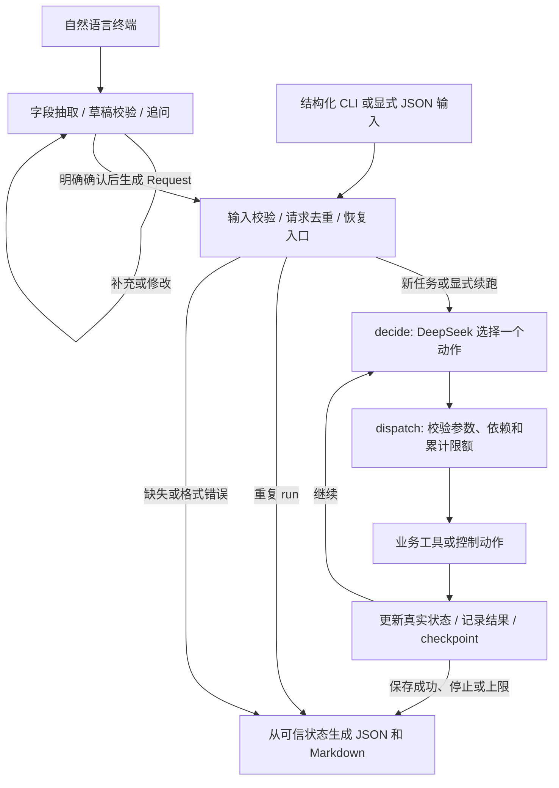

# 整理前历史快照

2026-10-31归档。本文保留整理前的规格/阶段状态，不代表当前结果；当前版本见[主文档](../../02-solution.md)。

# 解决方案与模块边界

## 总体执行图

`search -> revise_plan -> generate_script -> estimate_cost -> save_plan` 是正常路径示例，不是强制执行脚本。模型可补充检索、修订候选、复用脚本、再次估算或停止；依赖校验只拒绝不合法动作，不自动替模型选择合法动作。

## 模块表

| 模块/建议文件 | 负责 | 不负责 |
|---|---|---|
| `cli.py` | argparse 命令、输入/输出路径、退出码、环境读取 | 业务决策、SQL、提示词拼装 |
| `intake.py` | 带原文的字段更新、内存草稿、限定预算/时间解析、追问、确认与稳定Request | 工具调用、SQLite业务写入、替用户确认 |
| `scripts/interactive_planner.py` | 自然语言/JSON终端、摘要展示、调用现行service、独立需求事件 | 业务决策、重写成功状态 |
| `contracts.py` | Pydantic 请求/结果/工具 DTO；严格参数验证和 JSON Schema 导出 | 预算公式、模型调用 |
| `service.py` | run/show/resume、指纹比对、checkpoint 恢复、保存事实核对 | 自动选择候选、模型内部重试 |
| `graph.py` | StateGraph 两节点、路由、框架错误映射 | 通用工作流引擎、并行任务调度 |
| `agent.py` | 从状态构造模型上下文、一次动作决策、选择结果转换 | 执行工具、信任模型自报成功 |
| `model.py` / `deepseek.py` | 业务ModelClient、需求extract_intake、官方HTTPX适配、显式Fake与usage | 数据库操作、业务预算管理 |
| `prompts.py` | intake、planner、script三个版本化提示模板 | 根据 case_id 注入正确答案 |
| `tools.py` | 四个业务工具、两个控制动作的固定白名单分派 | 任意函数执行、文件系统/网络通用工具 |
| `domain.py` | 候选/脚本/估算依赖、缓存指纹、报价与期限校验、状态转换 | HTTP、SQL、模型自由文本解析 |
| `catalog.py` | 读取版本化合成资料、检索匹配与排序 | 互联网检索、向量数据库 |
| `storage.py` | 请求索引、事件、方案事务与唯一约束；checkpointer 生命周期 | 理解自然语言或修改预算 |
| `reporting.py` | 可信 JSON、Markdown、脱敏 Trace 导出 | 让模型填写最终成功状态 |

不为每种结构创建接口/工厂。仅外部非确定性边界 `ModelClient` 与 `Clock` 采用可注入协议，其余使用普通函数和一个 SQLite repository。

## 决策权分配

模型负责：检索语句；主素材选择；创意简述；制作档位；观察不满足约束后调整什么；可重试错误是否重试；何时停止。

程序负责：素材与来源存在性、类型与依赖；价格和工期；候选/产物指纹；执行限额；保存前重验；数据库事务；真实状态；Trace；无法继续时的明确未完成结果。

禁止程序写 `if over_budget: mode = basic`。允许程序把 premium/basic 的确定性报价和差额同时返回，下一步仍由模型选择。

## 脚本生成不是第二个自主 Agent

`generate_script` 内部通过同一个 ModelClient 发起一次专用生成请求，无工具、无自主循环。输入仅为当前主题、素材事实、创意简述和固定输出契约；输出 Pydantic 校验后形成脚本草稿。

该调用也计入模型调用上限。一次 planner 决策加一次 script 请求是两次模型调用，不伪装成一次。生成失败作为工具失败返回外层模型，是否再次生成由外层选择。

产品事实只允许来自素材。程序验证 source_ids 与所选素材一致、字段完整、长度与已知禁止表述；不声称能完全自动证明任意自然语言命题。评估阶段另核对事实支持性。

## 模型上下文

每次决策传入：不可变用户要求、可用动作 schema、报价表、当前候选、仍有效的脚本/估算摘要、最近工具观察、剩余限额。控制理由 `rationale` 为可公开的一句话依据，不能要求模型提交内部思维过程。

恢复时使用 checkpoint 中已完成的合法消息与状态；若遇到已提交方案，以数据库已提交事实为准结束。禁止伪造工具调用消息来填补历史。错误日志只包含可公开错误码与必要摘要。

### S4任务记忆与上下文边界（实现前，2026-10-30）

用户决定继续LangGraph路线，不引入Deep Agents或跨任务长期记忆。任务记忆为结构化业务状态、真实事件与框架checkpoint；开发用HANDOFF不进入应用。公开入口为`PlanningAgent(request, catalog, model, clock, repository, checkpointer).run(recursion_limit=80)`，返回内部AgentState，不冒充S5完整TaskResult。一次run启动/读取当前线程，重复run读已有checkpoint；跨进程resume归S6。

ModelClient增加`decide(context)->dict`，返回普通Chat Completions风格assistant消息，tool_calls内保留真实id、function.name与arguments原始JSON字符串。Fake增加显式decisions列表和独立decision_requests；不根据预算/失败内置决策。graph.py只连接decide/dispatch，agent.py承担协议、上下文及额度协调，LocalTools继续执行业务。

每次上下文含固定指令、六动作Schema、不可变请求/报价表、当前候选、有效产物ID/摘要、最近观察、已评估报价与未解决失败及剩余额度。仅向模型传最近完整调用/结果组，历史上限12000个JSON字符；旧组从真实结果生成动作名/ok/error_code摘要，不生成伪造消息或调用额外摘要模型。完整历史保留在checkpoint/events。总context UTF-8序列化不得超过65536字节，包含Schema；必要事实自身超限时以CONTEXT_LIMIT_REACHED停止，不删预算/期限或虚报token精确计数。真实token预算校准归S7。

## 真实依赖与替身

真实模式：真实 DeepSeek planner + 真实脚本生成；素材、估算、保存为实际本地函数，其中数据为合成资料。

离线模式：替换 ModelClient 为可配置的 Fake，其他工具、状态、存储、输出使用同一实现。Fake 使用结构化动作列表测试编排，不宣称模拟真实智能；`backend=mock` 必须贯穿结果和 Trace。

故障注入通过测试依赖和受控场景配置实现，不让模型接触场景期望或直接指定最终状态。工具返回失败是可见观察，调度器不替模型重试。
